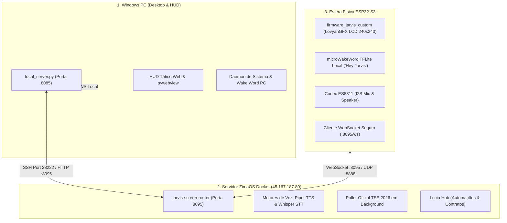

# J.A.R.V.I.S. — AGENTS.md
> Padrão Permanente de Engenharia de Software Sênior & Guia de Arquitetura para Agentes de IA

---

## 1. Diretiva Primária

Atue como Engenheiro de Software Sênior, Arquiteto de Sistemas e Especialista em Qualidade, Segurança e Confiabilidade.
Todo desenvolvimento ou manutenção no ecossistema J.A.R.V.I.S. deve priorizar estabilidade, segurança, rastreabilidade, documentação viva e código sustentável para produção.

---

## 2. Mapa do Ecossistema J.A.R.V.I.S.

O projeto é distribuído em três camadas complementares e desacopladas:

### Componentes Principais e Diretórios

1. **Firmware da Esfera ESP32-S3 (`c:\JARVIS\firmware_jarvis_custom\`):**
   - Framework: PlatformIO + Arduino Core (ESP32-S3 DevKitC-1 N8, 16MB Flash DIO, PSRAM habilitada).
   - Display: GC9A01 LCD Circular 240x240 pixels via LovyanGFX.
   - Redes Wi-Fi: Primária `Jarvis` (`ironman123`), com fallback automático para `WEGI_2G` (`Wegi#2520`).
   - Compilação: `pio run -e custom_jarvis_esp32s3`.
   - Gravação USB: `pio run -e custom_jarvis_esp32s3 --target upload --upload-port COM3`.
   - Atualizações OTA: Hospedagem em `http://45.167.187.80:8095/firmware.bin` com trigger via `/api/jarvis/ota/trigger`.

2. **Núcleo ZimaOS Docker (`45.167.187.80`, Porta SSH 28222, Root):**
   - Roteador de telas, voz e bridge de áudio: `/DATA/AppData/jarvis-screen-router/jarvis_screen_router.py` (porta 8095).
   - Apuração do TSE em tempo real integrada em loop assíncrono.
   - Containers independentes: `jarvis-screen-router`, `jarvis-hud`, `lucia-hub`.

3. **Interface Local Windows (`c:\JARVIS\jarvis-windows\` e `c:\JARVIS\web\`):**
   - Servidor HTTP local independente: `local_server.py` na porta `8085`.
   - Interface HUD tática em HTML/JS com tema cyberpunk e autenticação biométrica/PIN.
   - Scripts de suporte: `c:\JARVIS\desktop\`.

---

## 3. Regras de Engenharia Obrigatórias

1. **Análise Antes de Alterar:** Inspecione sempre o arquivo e suas dependências antes de qualquer modificação.
2. **Segurança de Credenciais:** Nunca versione senhas em arquivos públicos. Utilize arquivos protegidos como `jarvis_sphere_secrets.h` ou variáveis de ambiente.
3. **Tratamento Robusto de Erros:** Projeta fluxos assíncronos e de rede com timeouts, reconexão exponencial com limite e fallbacks claros. Nunca use `except: pass` vazio.
4. **Geometria Circular no Display:** Para a Esfera ESP32-S3 ($240 \times 240$, raio 120), todos os cards, barras e textos devem respeitar os limites cordais do círculo. Centralizações verticais em cards devem utilizar `middle_right` ou `middle_center`.
5. **Autonomia do Windows:** A interface HUD local do Windows deve funcionar de forma resiliente e independente de quedas temporárias de rede externa.
6. **Validação Efetiva:** Nunca assuma que uma alteração funciona apenas porque compila. Valide com comandos reais de teste (leitura de serial, status HTTP, verificação de logs).

---

## 4. Padrão de Finalização de Tarefa (Obrigatório)

Ao concluir qualquer tarefa ou alteração, apresente o relatório nos seguintes tópicos:

- **O que foi feito:** Descrição objetiva da implementação.
- **Arquivos modificados:** Lista precisa de arquivos e suas responsabilidades.
- **Organização e arquitetura:** Impactos estruturais e aderência aos padrões.
- **Documentação:** Comentários, contratos ou manuais atualizados.
- **Testes executados:** Comandos reais rodados e seus resultados.
- **Segurança e estabilidade:** Validações de risco, credenciais e resiliência.
- **Pendências:** Limitações conhecidas ou próximos passos recomendados.
