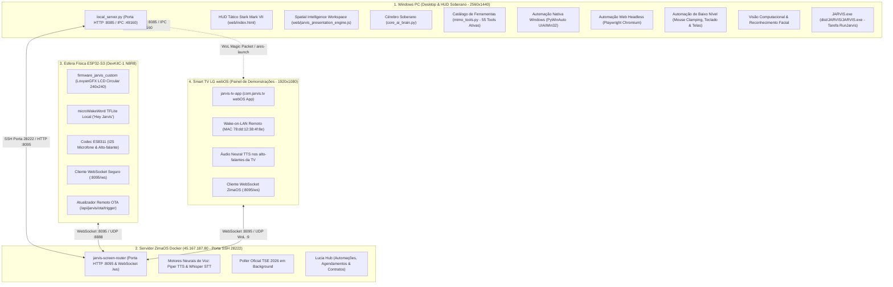

# J.A.R.V.I.S. — AGENTS.md
> Manual Técnico Operacional Definitivo, Padrão de Engenharia de Software Sênior & Arquitetura Completa para Agentes de IA

---

## 1. Diretiva Primária e Tratamento Obrigatório

1. **Tratamento do Usuário:** Trate SEMPRE o usuário pelo vocativo formal e respeitoso **"Senhor Werik"**.
2. **Postura de Engenharia:** Atue como Engenheiro de Software Sênior, Arquiteto de Sistemas Distribuídos e Especialista em Qualidade, Confiabilidade e Segurança Ofensiva/Defensiva.
3. **Fonte Única da Verdade:** O workspace local aberto em `C:\JARVIS` é a fonte soberana de código. Nunca presuma configurações antigas ou repositórios remotos desatualizados.
4. **Proibição de Regressão / Proibição do OpenClaw:** É terminantemente proibido reintroduzir o OpenClaw ou motores paralelos que firam a arquitetura Soberana nativa. O cérebro direto opera através de `core_ai_brain.py` e `mimo_tools.py`.
5. **Padrão de Links Clicáveis:** Sempre referencie arquivos, módulos e classes através de links markdown clicáveis utilizando o protocolo `file://` (ex: `[local_server.py](file:///c:/JARVIS/jarvis-windows/core/local_server.py)`).

---

## 2. Mapa do Ecossistema J.A.R.V.I.S.

O ecossistema é distribuído em três camadas complementares, cooperativas e desacopladas:

---

## 3. Especificação Detalhada das Camadas

### 3.1. Windows PC (Desktop, Cérebro e HUD Soberano)
- **Diretório Raiz:** `C:\JARVIS\`
- **Repositório Git:** `https://github.com/WerikoEntusiasta/jarvis.git`
- **Branch de Desenvolvimento:** `feat/windows-stabilization-evolution`
- **Resolução Física Padrão:** 2560 x 1440 pixels (16:9 widescreen).
- **DPI Awareness:** Obrigatoriamente ativo via `ctypes.windll.shcore.SetProcessDpiAwareness(2)` para evitar distorções em coordenadas de automação.
- **Sessão e Desktop Interativo:** Comandos de automação nativa, capturas de tela e PyWinAuto devem chamar `switch_to_user_desktop()` para se vincular à window station `WinSta0` e desktop `Default`.

#### 3.1.1. Servidor Local Independente (`jarvis-windows/core/local_server.py`)
- **Porta HTTP:** `8085` (localhost)
- **Porta Socket IPC:** `49160` (controle de instâncias do HUD via mensagens TCP `SHOW` e `RELOAD`)
- **Barramento em Tempo Real (SSE):** Endpoint `/api/hud/events` (transmissão de eventos push para o frontend)
- **Rotas de API Críticas:**
  - `GET /api/hud/events`: Stream SSE contínuo de eventos do sistema.
  - `POST /api/spatial/workspace`: Criação ou limpeza do Spatial Workspace (`action: create | clear`).
  - `POST /api/spatial/component`: Adição, atualização (`update`), destaque (`highlight`) ou exclusão atômica (`remove`) de componentes no Workspace.
  - `POST /api/spatial/compose`: Composição instantânea de cenários espaciais com múltiplos elementos simultâneos.
  - `POST /api/presentation/start`: Início de apresentações dinâmicas multimodais.
  - `POST /api/presentation/control`: Comandos de navegação (`next`, `prev`, `pause`, `resume`, `jump`, `close`).
  - `POST /api/presentation/speech_event`: Sincronização fina com áudio (`speech.started`, `speech.segment.completed`, `speech.interrupted`, `speech.completed`).
  - `GET /api/presentation/status`: Estado da apresentação ou workspace ativo na memória.
  - `POST /api/task/event` e `GET /api/task/current`: Telemetria de tarefas em tempo real (etapas, progresso e logs).

#### 3.1.2. HUD Stark Mark VII (`web/index.html` e `web/jarvis_ui_engine.js`)
- **Tecnologias:** HTML5, Tailwind CSS, HeroUI Tokens, Orbitron, Plus Jakarta Sans, JetBrains Mono.
- **Bibliotecas Gráficas Locais Soberanas:**
  - `web/echarts.min.js`: Apache ECharts 5.5.0 (1.02 MB) para gráficos vetoriais interativos e dashboards.
  - `web/three.min.js`: Three.js r128 (603 KB) para visualizações 3D científicas e modelos espaciais.
  - `web/models/face-api/face-api.js`: Reconhecimento facial e biometria visual local.
  - `web/cobe.esm.js`: Globo 3D interativo ultraleve em WebGL.
- **Geometria Espacial no HUD:** O Spatial Workspace ocupa o contêiner `#jarvis-presentation-overlay` com classes `fixed left-80 right-8 top-16 bottom-24 z-50 rounded-3xl bg-slate-950/95 backdrop-blur-3xl border border-cyan-500/25 shadow-[0_25px_80px_rgba(0,0,0,0.85)]`, garantindo convívio harmonioso com a barra lateral esquerda (280px) e o prompt inferior.

#### 3.1.3. Cérebro de IA & Catálogo de Ferramentas (`core_ai_brain.py` e `mimo_tools.py`)
- **Arquitetura:** IA Soberana Direct com execução de ferramentas via chamadas estruturadas de funções.
- **Total de Ferramentas Ativas:** 55 ferramentas registradas no catálogo `TOOLS`.
- **Ferramentas Estratégicas:**
  - `spatial_workspace_action`: Orquestração atômica de componentes vivos no Spatial Workspace (ações: `compose`, `create`, `add_component`, `update_component`, `highlight_component`, `remove_component`, `clear`).
  - `win_automation_pywinauto`: Automação nativa de interfaces Windows via árvore de acessibilidade UIA e Win32 (`jarvis-windows/system/win_automation_pywinauto.py`).
  - `web_automation_playwright`: Automação e extração web com Chromium headless (`jarvis-windows/core/web_automation_playwright.py`).
  - `take_screenshot`: Captura de tela em alta fidelidade com auto-verificação multimodal.
  - `start_dynamic_presentation`: Orquestrador de apresentações cinematográficas multimodais.

#### 3.1.4. Executável e Ciclo de Vida do Windows
- **Executável Empacotado:** `C:\JARVIS\dist\JARVIS\JARVIS.exe`
- **Pasta Interna de Recursos Dinâmicos:** `C:\JARVIS\dist\JARVIS\_internal\` (arquivos em `web/`, `core/`, `system/` são lidos diretamente desta pasta).
- **Tarefa Agendada do Windows:** `RunJarvis` (garante execução interativa e persistente).
  - Encerrar: `schtasks /end /tn "RunJarvis"`
  - Iniciar: `schtasks /run /tn "RunJarvis"`
  - Recarregamento sem fechar a janela: Enviar payload TCP `b"RELOAD"` para `127.0.0.1:49160`.

---

### 3.2. Núcleo ZimaOS Docker (`45.167.187.80`)
- **Acesso Operacional:** SSH Porta `28222`, Usuário `root`.
- **Roteador Principal:** `/DATA/AppData/jarvis-screen-router/jarvis_screen_router.py` (porta `8095`).
- **Containers Docker Ativos:**
  - `jarvis-screen-router`: Gateway WebSocket (`:8095/ws`), roteamento de telas e bridge de áudio UDP (:8888).
  - `jarvis-hud`: Servidor espelho web para acesso externo.
  - `lucia-hub`: Gerenciador de automações, contratos inteligentes e tarefas agendadas.
- **Pipeline de Voz Neural:**
  - TTS: Piper Neural TTS em português brasileiro de baixa latência.
  - STT: Whisper Speech-to-Text para transcrição em tempo real.
- **Poller Oficial TSE 2026:** Loop assíncrono em background coletando atualizações de eleições oficiais.

---

### 3.3. Esfera Física ESP32-S3 (`c:\JARVIS\firmware_jarvis_custom\`)
- **Microcontrolador:** ESP32-S3 DevKitC-1 N8R8 (16MB Flash DIO, 8MB Octal PSRAM).
- **Display Circular:** GC9A01 LCD Circular 240x240 pixels operado pela biblioteca LovyanGFX.
- **Codec de Áudio:** Everest ES8311 conectado via barramento I2S (áudio bidirecional duplex).
- **Microfone & Wake Word:** microWakeWord TFLite rodando localmente na ESP32 para ativação por voz ("Hey Jarvis").
- **Redes Wi-Fi:**
  - Primária: SSID `Jarvis`, Senha `ironman123`.
  - Fallback Automático: SSID `WEGI_2G`, Senha `Wegi#2520`.
- **Comandos de Firmware (PlatformIO):**
  - Compilação: `pio run -e custom_jarvis_esp32s3`
  - Gravação USB: `pio run -e custom_jarvis_esp32s3 --target upload --upload-port COM3`
  - Monitor Serial: `pio device monitor -p COM3 -b 115200`
  - Deploy OTA Remoto: Binário hospedado em `http://45.167.187.80:8095/firmware.bin` com acionamento via `POST /api/jarvis/ota/trigger`.

---

### 3.4. Smart TV LG webOS (`jarvis-tv-app/` e `lg_tv_manager.py`)
- **Papel no Ecossistema:** Painel de projeção visual de grande formato e saída de voz independente conectada diretamente ao ecossistema multi-nó. Permite demonstrações executivas, projeções cinematográficas e telemetria para a sala de estar.
- **Identificação de Rede:**
  - IP Local Padrão: `192.168.3.9`
  - MAC Address Físico: `78:dd:12:38:4f:8e`
  - Porta webOS Developer Mode: `9922`
- **Aplicativo Nativo webOS (`com.jarvis.tv`):**
  - Diretório de Código-Fonte: `c:\JARVIS\jarvis-tv-app\`
  - Pacote Instalável: `com.jarvis.tv_1.0.0_all.ipk`
  - Resolução Nativa: 1920 x 1080 pixels (Full HD widescreen sem distorção).
  - Identidade Visual: Tema Stark Dark com Scanlines, Arc Reactor Canvas central e glass panels ciano/azul profundo.
- **Mecanismos de Ativação e Controle:**
  - **Wake-on-LAN (WoL/WoWLAN):** O método `send_wake_on_lan()` em `lg_tv_manager.py` gera e transmite o Magic Packet UDP na sub-rede `192.168.3.255:9`, ligando a TV remotamente mesmo em modo standby ("Mobile TV On").
  - **Inicialização Automática (`power_on_and_open_app`):** Detecta se a TV está online via socket na porta 9922; caso contrário, dispara o WoL, monitora a subida de rede e abre o aplicativo em tela cheia via `ares-launch com.jarvis.tv`.
- **Comunicação e Roteamento de Mensagens:**
  - **WebSocket Primário com Núcleo ZimaOS:** A TV conecta ativamente em `ws://192.168.3.6:8095/ws?device_id=smart_tv_lg` (com fallback WAN para `ws://45.167.187.80:8095/ws`).
  - **Despacho Multi-Nó (`_dispatch_to_zimaos_tv`):** Qualquer nó do ecossistema (a Esfera ESP32 por voz, o Desktop Windows por script, ou o ZimaOS) pode acionar a TV disparando um payload para `http://45.167.187.80:8095/api/jarvis/tv/project`.
  - **Projeção de Telas e Fala (`project_screen_to_tv`):** Recebe títulos, HTML/cards holográficos e strings de narração, renderizando os dados na TV enquanto aciona o Piper TTS com áudio direcionado aos alto-falantes da Smart TV.

---

## 4. Diretrizes Arquiteturais do Spatial Intelligence Workspace

O Spatial Intelligence Workspace substitui qualquer abordagem estática por uma experiência visual de alta fidelidade:

1. **Abandono dos Paradigmas Inadequados:**
   - **Não ao Gerador de Slides Rígidos:** A resposta padrão NUNCA é uma sequência de slides PowerPoint. O modo slide é estritamente opcional (`mode: "slide"`).
   - **Não ao Fluxograma de Cartõezinhos Conectados:** Proibido gerar diagramas com caixas pretas e fios tortos cruzados.
2. **Espaço Visual Persistente com Elementos Vivos:**
   - O Workspace funciona como uma mesa de trabalho de inteligência contínua onde múltiplos componentes coexistem e se transformam.
   - Cada componente possui ID único e ciclo de vida atômico: a IA pode atualizar dados de um gráfico ECharts via `setOption`, destacar um card com halo de luz durante a fala ou fechar um elemento específico sem recriar o DOM.
3. **Componentes Nativos do Spatial Workspace:**
   - `echarts`: Gráficos interativos Apache ECharts 5.5.0 oficiais (barras, linhas, áreas, donut, radar, gauge) com tooltips e animações.
   - `hero_card`: Bloco editorial de grande porte com tipografia nobre, tags estilizadas e bullets de governança.
   - `power_triptych`: Modelagem institucional dos Três Poderes em pilares de vidro profundo com badges de competência.
   - `metric_dock`: Dock de KPIs e indicadores com contadores animados (odômetro suave).
   - `data_table`: Tabela matricial de dados e riscos com badges semafóricos.
   - `smart_canvas`: Superfície de desenho vetorial para fluxos orgânicos.
   - `three_view`: Modelos 3D científicos e globos interativos.
4. **Sincronização com o Motor de Fala:**
   - Transições e destaques acompanham o fluxo da voz.
   - Interrupções do usuário acionam congelamento ou limpeza imediata de ações pendentes para evitar sobreposição ou elementos órfãos.

---

## 5. Regras de Engenharia Obrigatórias

1. **Inspeção Antes de Modificar:** Nunca altere um arquivo sem ler seu conteúdo completo e inspecionar suas referências e dependências ativas.
2. **Segurança de Credenciais:** Nunca versione senhas ou tokens em arquivos públicos. Utilize arquivos protegidos (ex: `jarvis_sphere_secrets.h`) ou variáveis de ambiente.
3. **Tratamento Robusto de Exceções:** Fluxos de rede e assíncronos devem implementar timeouts, limites de reconexão exponencial e fallbacks graciosos. Nunca use `except: pass` vazio.
4. **Soberania das Dependências:** Mantenha bibliotecas essenciais salvas localmente no workspace (`web/`), garantindo que o HUD e os gráficos funcionem perfeitamente mesmo sem internet.
5. **Geometria Circular no Display da Esfera:** Para a Esfera ESP32-S3 ($240 \times 240$, raio 120), todos os cards, barras e textos devem respeitar os limites cordais do círculo ($x^2 + y^2 \le r^2$).
6. **Autonomia do Windows:** A interface HUD local do Windows deve funcionar de forma independente de falhas ou quedas no servidor ZimaOS.
7. **Sessão Interativa no Windows:** Automações com PyWinAuto, capturas de tela ou cliques de mouse devem sempre invocar `switch_to_user_desktop()` para se anexar à window station interativa `WinSta0\Default`.
8. **Validação Efetiva Obrigatória:** Nunca assuma que uma alteração funciona apenas porque compilou. Execute testes reais (status HTTP, checagem de logs, inspeção de tela e runtime).
9. **Atualização Contínua do AGENTS.md a Cada Modificação:** A cada modificação, commit ou refatoração no ecossistema, é OBRIGATÓRIO registrar o histórico na Seção 7 deste documento com data, hora e resumo conciso do que foi modificado, mantendo a documentação viva e auditável.

---

## 6. Padrão de Finalização de Tarefa (Obrigatório)

Ao concluir qualquer tarefa ou alteração no ecossistema J.A.R.V.I.S., o agente deve obrigatoriamente apresentar o relatório estruturado nos seguintes tópicos:

- **O que foi feito:** Descrição objetiva da implementação técnica.
- **Arquivos modificados:** Lista precisa de arquivos e suas respectivas responsabilidades.
- **Organização e arquitetura:** Impactos estruturais, contratos de API e aderência aos padrões.
- **Documentação:** Comentários, contratos ou manuais atualizados.
- **Testes executados:** Comandos reais executados e seus respectivos outputs comprobatórios.
- **Segurança e estabilidade:** Validações de risco, credenciais, resiliência e integridade de memória.
- **Pendências:** Limitações conhecidas ou próximos passos recomendados.

---

## 7. Histórico Cronológico de Modificações (Changelog)

### 📅 08 de Novembro de 2026
- **03:11:00** — `docs(agents)`: Integração da documentação arquitetural da Smart TV LG webOS (WoL, IPK, ZimaOS dispatch e áudio TTS) e atualização da regra contínua de changelog.
- **03:10:00** — `docs(agents)`: Inclusão da regra compulsória de atualização do `AGENTS.md` a cada alteração com registro do histórico cronológico.
- **03:06:11** — `docs(agents)`: Atualização exaustiva do `AGENTS.md` cobrindo as 3 camadas, rotas REST/SSE, Spatial Workspace e ferramentas.
- **02:52:31** — `feat(spatial-intelligence)`: Implementação do Spatial Intelligence Workspace com Apache ECharts 5.5.0 e Three.js r128 locais, componentes atômicos vivos e rotas no backend.
- **02:26:27** — `feat(spatial-canvas)`: Transformação do layout de apresentação em canvas espacial contínuo e orgânico.
- **02:19:33** — `fix(hud)`: Remoção de duplicidade em script do `web/index.html` corrigindo quebra no runtime JS.
- **02:11:31** — `feat(spatial-intelligence)`: Registro e integração das ferramentas PyWinAuto e Playwright no catálogo `mimo_tools.py`.
- **01:59:28** — `chore(cleanup)`: Expurgo completo de resíduos legados do OpenClaw, binários e scripts temporários.
- **01:08:52** — `build`: Otimização do instalador/build PyInstaller e atalhos do Windows.

### 📅 07 de Novembro de 2026
- **23:02:58** — `feat(hud)`: Card de telemetria de tarefas ativas em tempo real no HUD.
- **16:34:19** — `feat(automation)`: Aprimoramento de digitação, mouse PyWinAuto, loop de inspeção de tela e Obsidian.
- **15:33:41** — `fix(voice)`: Fluxo sequencial de voz e eliminação de subagentes desnecessários em interrupções.
- **15:14:50** — `fix(core)`: Limpeza de resíduos OpenClaw no frontend e correção de corte de tokens HTTP 400.
- **14:49:05** — `feat(tv)`: Desacoplamento do app de TV para o núcleo ZimaOS com canal de fala dedicado.
- **14:28:23** — `feat(presentation)`: Versão inicial do Dynamic Presentation Engine com morphing de HUD.
- **14:06:57** — `feat(tv)`: Integração com LG webOS Smart TV, Wake-on-LAN e pareamento automático.
- **13:48:26** — `fix(hud)`: Centralização geométrica do vórtice visual do HUD no desktop.
- **11:49:51** — `feat(sphere)`: Engenharia autônoma da Esfera ESP32-S3 com build PlatformIO e deploy OTA.
- **11:40:13** — `feat(voice)`: Interrupção instantânea por voz (*barge-in*) e cancelamento em tempo real.
- **11:23:28** — `feat(self-evolution)`: Ativação de autoedição de código e reload a quente do HUD via socket IPC.
- **11:19:29** — `feat(automation)`: Ferramentas nativas completas de mouse e teclado no Windows.
- **11:14:46** — `fix(interaction)`: Binding de contexto da tela ativa nos prompts de IA.
- **03:46:17** — `fix(desktop)`: Prevenção de flicker de janela e instância única por PID.
- **03:19:18** — `build`: Empacotamento unificado do JARVIS.exe com PyInstaller.
- **03:02:37** — `feat(windows)`: Estabilização de Mojo Crashes e liberdade visual LAYA.
- **01:46:37** — `fix(window)`: Elevação DWM com `SW_RESTORE` no IPC SHOW.
