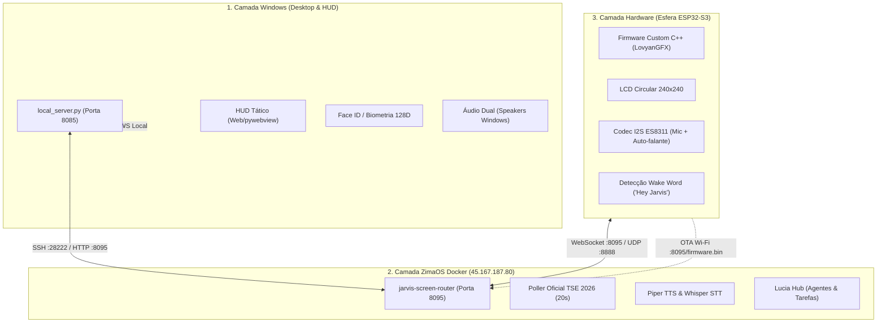

# J.A.R.V.I.S. — Sistema de Inteligência Operacional & HUD Tático Multi-Camada

> Padrão Permanente de Engenharia de Software Sênior | Ecossistema Integrado Windows, Docker & Hardware ESP32-S3

---

## 1. Visão Geral do Sistema

O **J.A.R.V.I.S.** (Just A Rather Very Intelligent System) é um ecossistema de inteligência operacional pessoal inspirado na ficção e projetado para produção no mundo real. O sistema integra hardware físico dedicado, nós de processamento distribuído em nuvem privada e interfaces táticas em tempo real para o usuário principal (**Senhor Werik**).

O ecossistema opera de forma desacoplada em três pilares:

1. **Nó Local Windows (`Windows PC`):** HUD tático em HTML5/Canvas/WebGL com suporte biometria facial, controle do sistema operacional Windows, áudio dual de alta fidelidade e monitoramento contínuo de hardware.
2. **Núcleo ZimaOS Docker (`45.167.187.80`):** Servidor central de inteligência, roteamento de telas (`jarvis-screen-router` na porta 8095), motores neurais de voz (Piper TTS & Whisper STT), poller em tempo real de dados oficiais (TSE) e hub de automação residencial.
3. **Esfera Física ESP32-S3 (`Hardware Embarcado`):** Microcontrolador ESP32-S3 com display LCD circular GC9A01 (240x240 pixels), microfone com cancelamento e codec de áudio ES8311, detecção local de Wake Word (*"Hey Jarvis"*) e conectividade contínua via WebSocket.

---

## 2. Mapa Arquitetural



---

## 3. Tecnologias Empregadas

| Domínio | Tecnologias |
|---|---|
| **Firmware Embarcado** | C++20, PlatformIO, Arduino Core ESP32, LovyanGFX, WebSocketsClient, ArduinoJson, HTTPUpdate, FreeRTOS |
| **Backend & Roteamento** | Python 3.11+, aiohttp, asyncio, websockets, NumPy, psutil |
| **Inteligência Artificial & Voz** | Whisper (faster-whisper STT), Piper TTS, ElevenLabs API, microWakeWord TFLite |
| **Interface do Usuário** | HTML5 Canvas, WebGL, CSS Moderno, pywebview, JavaScript assíncrono |
| **Segurança & Autenticação** | Face-api.js (vetor 128D), SQLite, HMAC SHA-256 tokens, RBAC multi-nível, SSL/TLS |
| **Infraestrutura & Deploy** | Docker Compose, ZimaOS, Linux Alpine/Debian, OTA sem fio |

---

## 4. Pré-requisitos

- **Windows PC:** Windows 10/11 x64, Python 3.11+, Git, VS Code ou Antigravity IDE.
- **Hardware Embarcado:** ESP32-S3 DevKitC-1 N8 (16MB Flash, PSRAM), cabo USB-C de dados de alta velocidade (porta `COM3`).
- **Servidor ZimaOS:** Docker engine instalado, porta SSH `28222` liberada, conectividade com `45.167.187.80`.

---

## 5. Instalação e Configuração

### 5.1 Configuração das Variáveis de Ambiente

Copie o template `.env.example` para `.env` na raiz do projeto e configure suas credenciais:

```bash
cp .env.example .env
```

> [!CAUTION]
> **Segurança de Credenciais:** Nunca versione o arquivo `.env` nem o arquivo `include/jarvis_sphere_secrets.h`. Certifique-se de mantê-los no `.gitignore`.

### 5.2 Ambiente Local Windows

1. Crie o ambiente virtual:
   ```powershell
   python -m venv venv
   .\venv\Scripts\Activate.ps1
   ```
2. Instale as dependências:
   ```powershell
   pip install -r requirements.txt
   ```
3. Inicie o servidor local:
   ```powershell
   python server.py
   ```

### 5.3 Compilação e Gravação da Esfera ESP32-S3

Acesse o diretório do firmware e utilize o PlatformIO:

```powershell
cd firmware_jarvis_custom

# Compilação limpa
pio run -e custom_jarvis_esp32s3

# Gravação via USB (Porta COM3)
pio run -e custom_jarvis_esp32s3 --target upload --upload-port COM3

# Monitor serial em tempo real (115200 baud)
pio device monitor -p COM3 -b 115200
```

---

## 6. Operação das Telas e Modos da Esfera

O firmware da esfera física opera uma máquina de estados finitos (`DisplayMode`):

- **`kStandby`:** Modo de repouso com relógio NTP sincronizado, temperatura e status da bateria.
- **`kHappy` / `kSad` / `kAngry`:** Expressões robóticas dinâmicas em alta resolução com anéis de LED sincronizados.
- **`kSpotify`:** Painel tático de controle de mídia com botões de reproduzir, pausar, avançar e volume.
- **`kTelemetry`:** Monitoramento em tempo real do PC Windows (CPU, RAM, GPU temperatura e VRAM).
- **`kElection`:** Tela de apuração em tempo real oficial do TSE para Eleições Presidenciais (Lula x Flávio Bolsonaro) com cálculo cordal para display circular, percentuais e contagem de votos atualizada a cada 20 segundos.

---

## 7. Atualizações Over-The-Air (OTA)

Para atualizar a esfera física remotamente sem conectar o cabo USB:

1. Compile o novo firmware:
   ```powershell
   pio run -e custom_jarvis_esp32s3
   ```
2. O binário compilado estará em `.pio/build/custom_jarvis_esp32s3/firmware.bin`.
3. Sincronize o binário com o ZimaOS:
   ```powershell
   python scripts/sync_firmware_zimaos.py
   ```
4. Dispare a atualização OTA via HTTP POST:
   ```bash
   curl -X POST http://45.167.187.80:8095/api/jarvis/ota/trigger
   ```
5. O display da Esfera indicará o progresso de download e reiniciará automaticamente com a nova versão.

---

## 8. Verificação e Testes

Consulte o guia dedicado em [`docs/testing.md`](file:///c:/JARVIS/docs/testing.md) para procedimentos de validação:

- Teste de comunicação serial e telemetria: `scripts/read_com3_logs.py`
- Teste de áudio dual e síntese de voz: `server.py`
- Verificação de containers no ZimaOS: `scripts/diagnose_status.py`

---

## 9. Estrutura de Diretórios

```
c:\JARVIS\
├── AGENTS.md                  # Padrão Permanente de Engenharia & Arquitetura de IA
├── README.md                  # Este documento (Visão Geral & Guia do Ecossistema)
├── .env.example               # Template de variáveis de ambiente seguras
├── requirements.txt           # Dependências Python do ecossistema
├── server.py                  # Servidor central local Windows (HUD & APIs)
├── docs/                      # Documentação técnica consolidada
│   ├── architecture.md        # Especificação detalhada da arquitetura
│   ├── development.md         # Guia do desenvolvedor e padrões de código
│   ├── testing.md             # Rotinas de validação e testes automatizados
│   └── deployment.md          # Procedimentos de deploy e gravação
├── firmware_jarvis_custom/    # Código-fonte C++ PlatformIO da Esfera ESP32-S3
│   ├── platformio.ini         # Configuração de build, memórias e partições
│   ├── src/main.cpp           # Loop principal, LovyanGFX, Wi-Fi e WebSocket
│   └── include/               # Headers de segredos e definições de hardware
├── jarvis-windows/            # Aplicação nativa Windows, HUD e controladores
├── scripts/                   # Scripts utilitários de manutenção e automação
└── scratch/                   # Scripts legados e logs temporários arquivados
```

---

## 10. Suporte e Manutenção

Para diretrizes de contribuição, conformidade arquitetural e regras obrigatórias de engenharia, consulte impreterivelmente o documento [`AGENTS.md`](file:///c:/JARVIS/AGENTS.md).
