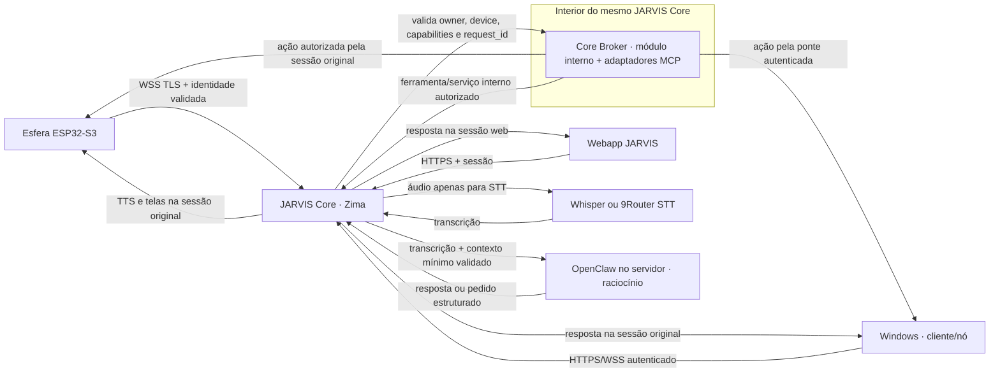

# CONTEXTO TÉCNICO PARA AGENTES J.A.R.V.I.S.

> **IMPORTANTE**: Este arquivo documenta o estado atual, arquitetura, containers e scripts do ecossistema J.A.R.V.I.S. **Todo agente que realizar alterações deve atualizar este arquivo.**

---

## Estado de progresso — JARVIS Core e conexão da esfera (11/10/2026 · 05:37 BRT)

> **Leia esta seção antes das notas históricas abaixo.** Ela substitui qualquer frase antiga que diga “voz da esfera validada E2E” ou que ponha todo o tráfego na porta 8095.

- Pedido dos 8 pontos: **11/10/2026 às 00:41:45**, horário de São Paulo. Tempo decorrido até esta atualização: **4h55min59s**.
- Workspace usado: `C:\JARVIS`. Não acessar nem depender de `D:`.
- Última leitura de runtime no Zima às **05:18 BRT**: containers `jarvis-hud` (Core) e `whisper` reportaram **healthy**; foi confirmada conectividade TCP do container Core ao listener Whisper. Nenhum áudio real foi transcrito nesta etapa.
- OpenClaw está em execução no Zima e o Core já tem rota SSH para chamar `openclaw agent` dentro do container. O proprietário informou que os créditos do agente acabaram e serão resolvidos amanhã; **não repetir chamada ao agente hoje**. O health check Docker do OpenClaw também reportou `unhealthy`, apesar do processo/Gateway estar ativo; investigar amanhã junto com a disponibilidade de créditos.
- O prompt enviado ao OpenClaw foi reduzido no código local do Core para um envelope curto: origem verificada, usuário/papel quando há sessão e transcrição. Só a chamada interna da sessão WSS autenticada da esfera pode marcar seu `device_id` como autenticado. Essa alteração está em `server.py` e **ainda não foi implantada/testada no Zima**.
- A sessão física WSS não permaneceu ativa. No último snapshot, não havia conexão estabelecida em 8095 nem 8096 e não havia evento STT recente. Ainda **não** foi validada uma fala real do microfone, a resposta OpenClaw ou o TTS no alto-falante da esfera.
- Investigação local da queda (11/10/2026, cerca de 05:37 BRT; leitura de código/configuração, sem fala nem acesso ao dispositivo): **causa da sessão que cai ainda não determinada**. Foi encontrada uma divergência relevante: `.env.example` define `SPHERE_WS_PORT=8095`, mas o Compose do Core publica e configura `8096`, e o firmware ESP32 tem `kZimaOsAudioPort=8096`. A divergência pode confundir inicialização local/configuração; não prova a causa da queda na instalação atual porque o Compose sobrescreve para 8096. O servidor usa keepalive WebSocket (ping e timeout de 20 s); o firmware chama `loop()` da biblioteca e depende do mecanismo dela para reconectar, sem diagnóstico próprio do código de fechamento. O servidor registra autenticação e motivo genérico de encerramento, mas não registra código/razão WebSocket — logo, os dados atuais não distinguem perda de Wi-Fi, timeout de keepalive, encerramento do peer, reinício do Core ou falha de áudio. Amanhã: conferir a configuração efetiva implantada sem exibir segredos, coletar apenas timestamps/close-code/etapa do handshake no Core e serial, observar se reconecta, e então testar uma fala curta.
- Firmware ESP32-S3 compilado e gravado por USB. Uma leitura em COM3 reiniciou a placa mesmo com DTR/RTS baixos; as mensagens “WebSocket conectado” são genéricas e não distinguem os canais. Evite abrir a serial sem considerar esse reset.
- Não afirmar que a tarefa está concluída até manter WSS conectado e completar uma fala real, do wake word ao áudio de resposta e retorno visual.

### Regra arquitetural obrigatória — Core e Broker são uma central só

Ver também [docs/JARVIS_CORE_ARQUITETURA.md](docs/JARVIS_CORE_ARQUITETURA.md). ESP32/esfera, Windows e webapp devem se comunicar apenas com o JARVIS Core no Zima. **Core Broker não é outro serviço ou central: é um módulo interno do mesmo JARVIS Core/runtime**, junto aos adaptadores MCP e ferramentas. O Core autentica e resolve usuário + dispositivo, recebe áudio, transcreve com Whisper ou modelo 9Router dedicado a STT, monta contexto curto com transcrição e capacidades autorizadas, e então chama OpenClaw no servidor para raciocínio. OpenClaw não atende dispositivos nem hospeda MCP/ferramentas JARVIS; pedidos de ação retornam ao Core e são despachados internamente pelo Broker, que valida escopo e roteia a ferramenta para o dispositivo vinculado ao usuário e à solicitação. Resposta/TTS volta pela mesma sessão/dispositivo de origem. **Essa é a arquitetura-alvo; a integração completa e o round-trip de uma ferramenta ainda não foram comprovados.**

**Proibição:** não iniciar nem usar OpenClaw no Windows, não conectar cliente Windows diretamente a Gateway OpenClaw e não configurar MCP individual em clientes. A conexão Windows→OpenClaw Gateway foi removida do caminho de inicialização do app fonte; o módulo antigo está inativo e será retirado após atualizar/validar o executável distribuído.

**Onde parou / próximo trabalho, por ordem:** (1) amanhã validar o health check/Gateway e uma resposta do agente quando houver créditos; (2) implantar a versão do Core com contexto compacto e validar Core→Whisper→OpenClaw; (3) integrar/organizar o Broker como módulo interno do Core e provar um pedido de ferramenta com validação de usuário, dispositivo, capacidade e `request_id` — não criar um serviço Broker separado; (4) manter a esfera no WSS `:8096`, transcrever uma fala real e verificar retorno de áudio/tela pela mesma sessão. A esfera ainda mantém o canal direto HTTP/WS `:8095` para tela/controle. Não declarar fluxo centralizado nem tudo funcional até completar esses passos. O Windows ainda inicia uma cópia local de `server.py` e voz/console/ilha usam `localhost:8080`; handlers com `device_id` recebido do cliente/“última esfera” também precisam de escopo autenticado. Testes do agente e da conversa física foram deixados para amanhã conforme orientação do proprietário.

### Mapa do fluxo-alvo (fonte da verdade)

### Rotas Windows — conteúdo que pode sair do PC

- **Voz local (legado a migrar):** `desktop/audio_listener.py` ainda envia WAV/texto a `localhost:8080/api/transcribe` e `/api/chat`. O app sobe uma cópia local de `server.py`, portanto esse tráfego ainda não está centralizado no Zima; o texto pode seguir daí ao OpenClaw por SSH. A resposta é reproduzida no Windows.
- **Eventos Windows:** a antiga classe `OpenClawConnection` encaminhava gestos/presença/clipboard diretamente ao Gateway; o app fonte não a inicia mais. Os watchers ainda rodam localmente. Não reativar nem transmitir clipboard por padrão; eventos necessários devem ser enviados ao Core com escopo e consentimento.
- **Comandos remotos ao Windows:** `RemoteCommandBridge` consulta `/api/remote/poll` no Core por HTTPS; executa no `CommandBus` e publica resultado em `/api/remote/result`. Este é o único caminho remoto Windows que deve permanecer, após substituir a credencial compartilhada por identidade autenticada do nó e vincular ações ao owner/request.
- **Telemetria para a esfera:** `desktop/pc_screen_rotator.py` contém envio UDP direto/broadcast para `:8888` e alternativa de telas via SSH → HTTP `:8095`. Não foi encontrada inicialização automática desse rotator no `desktop/app.py`; não marcar como daemon ativo sem comprovar o processo.
- `window.changed` e `system.telemetry` são emitidos no EventBus local; não são enviados ao Core no fluxo atual.

### Situação dos 8 pontos

| # | Estado | O que existe / o que falta |
|---|---|---|
| 1 Wake word “Jarvis” | Parcial | openWakeWord genérico `hey_jarvis`, limiar mais baixo e gate com fala + dois sinais; não é um modelo treinado na voz do Werik. |
| 2 Whisper mais rápido | Parcial | Serviço no Zima saudável; sem medida de frase real vinda da esfera. |
| 3 Silero VAD ~700 ms | Código implantado | Runner ONNX e fallback RMS no Core; uso em sessão física ainda não confirmado. |
| 4 Atalhos simples | Implementado no Core | Hora, clima, timer e alarme; percurso físico ainda sem teste. |
| 5 Streaming | Não confirmado | Há caminho opcional no código; configuração e resposta streaming em produção não comprovadas. |
| 6 Bipe/rosto/estados | Firmware gravado | Código inclui retorno visual/sonoro; tela não foi validada durante conversa real. |
| 7 Interromper/AEC | Pendente | Microfone é bloqueado durante TTS para evitar eco; AEC ESP-SR ainda não integrado/testado. |
| 8 Menos banda | Parcial | Firmware aplica gate local de fala; Opus e wake word inteiramente no ESP ainda pendentes. Áudio só deve ser afirmado como protegido no WSS :8096. |

### Segurança e rota legada

- Não registrar senha, token, segredo HMAC, private key ou conteúdo de áudio neste arquivo. Credenciais devem ficar em armazenamento protegido, não em Markdown/Compose versionável.
- **Pendência de segurança encontrada:** `docker-compose.yml` contém valores de credenciais diretamente no arquivo. Não copiá-los para logs, chat ou documentação. Antes do próximo deploy, movê-los para segredo/ambiente protegido preservando a configuração ativa; depois rotacionar credenciais expostas sem interromper os serviços.
- `:8095` é o Screen Router legado de tela/controle, em HTTP/WS sem TLS. Embora o Core possa chamá-lo internamente, o dispositivo não deve conectar diretamente a ele no alvo; migrar a sessão de tela/controle para WSS do Core `:8096` ou colocá-lo estritamente atrás de um proxy Core autenticado. O firmware atual manda áudio binário por WSS `:8096`.
- Ainda existe no código do Screen Router um pipeline legado de voz em `:8095`; se receber áudio, pode gravar `/tmp/utt_last.wav`. Não apagar sem checar dependências, mas trate-o como candidato a desativação/migração e não como fluxo novo aprovado.
- Arquivos de referência/snapshot e scripts standalone listados no HTML não são automaticamente descartáveis; mantenha cópias até confirmar que não são necessários para recuperação.

---

## 1. Visão Geral da Arquitetura

> **Nomenclatura:** “JARVIS Core” é o runtime/serviço central. “Core Broker” é a camada interna de execução e roteamento de ferramentas desse Core; não deve ser implantado nem desenhado como uma central independente. Hoje a existência de handlers/MCP no serviço Core não prova que o ciclo OpenClaw→Broker→ferramenta→resultado→mesmo turno esteja integrado; isso segue pendente.

O ecossistema **J.A.R.V.I.S.** é composto por:
1. **PC Local (Windows)**: Hospeda os scripts locais, coleta de telemetria da máquina (CPU, RAM, GPU NVIDIA, VRAM) e integração de mídia com o Spotify via Windows SMTC / ctypes.
2. **Servidor ZimaOS (`127.0.0.1`)**: Servidor de containers Docker na nuvem/rede local.
3. **Esfera AI (ESP32-S3)**: Dispositivo físico `jarvis_sphere_esp32s3` com tela visual, microfone, alto-falante e touch screen.

---

## 2. Servidores e Containers (ZimaOS `127.0.0.1`)

- **Host SSH**: `127.0.0.1`. Usar credenciais já provisionadas em armazenamento protegido; nunca registrar senha no contexto.
- **Container `jarvis-screen-router`**:
  - **Diretório**: `/DATA/AppData/jarvis-screen-router`
  - **Script**: `jarvis_screen_router.py`
  - **Porta**: `8095` (HTTP & WebSocket)
  - **Funções**:
    - WebSocket Server em `GET /ws` para conexão direta com a Esfera ESP32-S3.
    - Handshake `type="hello"` -> registra `device_id="jarvis_sphere_esp32s3"`.
    - Transmissão não-bloqueante de cards de tela via `POST /api/jarvis/show_screen`.
    - Captura de cliques em botões e gestos de swipe (`jarvis.button_clicked`).
    - Gestão e gatilho de atualizações OTA (`GET /firmware.bin`, `POST /api/jarvis/ota/trigger`).
    - **Rota principal atual**: HTTP/WebSocket para tela, toque, eventos e OTA legado. O código ainda contém um pipeline antigo de voz sem TLS, mas não é o canal de áudio do firmware atual.
- **Container `jarvis-hud`** (núcleo HTTP):
  - **Diretório**: `/DATA/AppData/jarvis-hud`
  - **Portas**: `8085→8080` (HTTP), `8087→8081`, `8086→8082`, `8096→8096` (WSS da esfera)
  - **Funções**: `/api/chat`, `/api/transcribe`, `/api/tts_pcm`, `/api/node/*`, Spotify Web API, fila de comandos remotos, gate facial, SSE.
- **Container `whisper`** (STT):
  - **Imagem**: `fedirz/faster-whisper-server:latest-cpu` (modelo `Systran/faster-whisper-small`), porta `8000`, endpoint OpenAI `/v1/audio/transcriptions`.
  - **IMPORTANTE**: precisa de CPU/RAM suficientes. Sem limites ele roda em 1 CPU (~65s/áudio). Configurado para **3.5 CPU / 6 GB** (~24s). Limites no compose `/var/lib/casaos/apps/compose-d613ebc771729e81/docker-compose.yml`.

> **Nota sobre o container legado**: o container `xiaozhi-esp32-server` foi removido. A ponte de voz nova vive no Core `jarvis-hud` em WSS `:8096`; `:8095` permanece necessário para compatibilidade de telas/controle.

---

## 3. Daemons e Scripts no PC Windows (`c:\JARVIS`)

### `C:\JARVIS\desktop\pc_screen_rotator.py`
Script standalone no Windows (execução automática não confirmada) que:
1. Coleta métricas de telemetria em tempo real:
   - **CPU**: % de uso (`psutil`)
   - **RAM**: GB usados / totais e % de uso
   - **GPU NVIDIA**: Temperatura (°C), % de uso e VRAM usada/total (`nvidia-smi`)
2. Controla o Spotify via `winsdk.windows.media.control` e `ctypes` (Volume UP/DOWN, Play/Pause, Next, Prev, faixa/artista atual).
3. Pode alternar telas/telemetria da Esfera ESP32-S3 se for iniciado:
   - **Tela 1: J.A.R.V.I.S. Standby HUD** (Design visual limpo com status dos sistemas)
   - **Tela 2: Rig Telemetria Windows** (Design em barras visuais de progresso `[████████░░]`)
   - **Tela 3: Spotify Media Player** (Controle de música, volume, faixa atual e botões touch)

---

## 4. Endpoints HTTP / WebSocket (`8095` e `8096`)

| Método | Endpoint | Descrição |
|---|---|---|
| `GET` | `:8095/ws` | WS legado de controle/telas; sem TLS |
| `POST` | `/api/jarvis/show_screen` | Envia card visual para a tela da Esfera |
| `GET` | `/firmware.bin` | Download do firmware binário para OTA |
| `POST` | `/api/jarvis/ota/trigger` | Dispara atualização OTA nas sessões ativas |
| `POST` | `/api/jarvis/firmware/upload` | Upload de novo arquivo `firmware.bin` |

### 4.1 Pipeline novo de voz da Esfera (implantado; E2E físico pendente)

Fluxo novo: **Esfera (mic)** → WSS `:8096` (TLS + HMAC) → `sphere_audio_bridge.py` no Core → wake word/VAD no `sphere_voice.py` → Whisper → atalho local ou agente OpenClaw no Zima → TTS PCM → volta pelo mesmo WSS `:8096` → alto-falante/estados do visor.

- Estado observado: Core/Whisper saudáveis; TLS + HMAC autenticaram a esfera uma vez, mas o dispositivo não manteve sessão. Não há transcrição física, resposta OpenClaw ou TTS confirmados.
- Wake word do Core: openWakeWord com fallback genérico `hey_jarvis`; limiar está configurado mais baixo que o histórico. Não confundir com wake word rodando integralmente no ESP32.
- Silero ONNX e janela de fala têm implementação; ainda é necessário provar a seleção e latência do VAD numa conversa física.
- `audio_params` no `hello`: `format=pcm`, `sample_rate=16000`, `channels=1`, `frame_duration=60`.
- O WSS envia status de escuta/transcrição/envio/pensamento/erro/sucesso; a validação visual desses estados está pendente.
- O áudio de resposta é enviado como frames binários (`WStype_BIN`) que o firmware escreve no I2S (volume DAC ES8311 no máximo, `0x32=0xFF`).
- Firmware novo foi gravado via USB; ainda falta confirmar áudio de ida/volta na unidade real.
- **Rota antiga :8095:** o router contém código de voz sem TLS e grava temporariamente `/tmp/utt_last.wav`; firmware atual só envia áudio pelo canal WSS separado `:8096`.

### 4.1.1 Voz nativa do Windows (fluxo separado)

`desktop/audio_listener.py` captura áudio no PC, envia WAV para `localhost:8080/api/transcribe`, passa o texto a `localhost:8080/api/chat` e reproduz a resposta no Windows. A transcrição pode usar Whisper local ou encaminhamento ao serviço Whisper conforme configuração. Não confundir este fluxo com o áudio da Esfera.

### 4.2 Controle da Esfera pelo Núcleo e pelo OpenClaw (device-aware)

O **núcleo** (`jarvis-hud`, :8085) é o centro de controle da esfera:

| Método | Endpoint (core :8085) | Descrição |
|---|---|---|
| `POST` | `/api/esfera/show_screen` | Exibe card na tela da esfera (repassa ao router :8095). |
| `POST` | `/api/esfera/emotion` | Muda o rosto da esfera (`happy`/`sad`/`angry`/`spotify`/`standby`). |

- **Origem device-aware:** o router envia `{"message","device_id","source":"esfera"}` ao `/api/chat` do núcleo. O núcleo guarda a última esfera de origem (`_ESFERA_STATE["last_device"]`) e usa esse `device_id` por padrão ao exibir na esfera — a resposta vai para a **esfera certa**.
- **OpenClaw:** ferramentas MCP `jarvis-hud__exibir_na_esfera(titulo, mensagem, botao1, botao2)` e `jarvis-hud__mostrar_rosto_esfera(emocao)`. O núcleo injeta a origem no contexto do OpenClaw quando o comando vem da esfera; o OpenClaw exibe na tela dela. (As `allowedTools` do OpenClaw já têm o wildcard `jarvis-hud__*`.)
- **MCP:** `mcp>=1.2.0,<2` (o mcp 2.x renomeou `FastMCP`). O `mcp_hud_server.py` roda em background no `jarvis-hud` (CMD: `python mcp_hud_server.py & exec python server.py`).

---

## 5. Instruções para Futuros Agentes

1. **Não voltar a mover o áudio da esfera para `:8095`**: controle/tela legado usa WS sem TLS; voz nova deve usar somente WSS `:8096` com TLS + HMAC. O router `:8095` continua necessário para compatibilidade visual.
2. **Atualização do `contexto_para_agentes.md`**: Toda alteração em portas, containers, rotas ou scripts no Windows/ZimaOS deve ser registrada aqui.
3. **Comunicação com o ESP32**: Os payloads de tela devem sempre utilizar `timeout: 0` e `wait: False` para evitar bloqueio HTTP, exceto quando aguardando input síncrono.
4. **Telas**: Envio para esfera é sem fio pela API/WS do Screen Router `:8095`; separar isso do canal de áudio WSS `:8096`.
5. **Voz**: PCM mono 16 kHz s16le. Não afirmar performance/latência do Whisper nem OpenClaw na esfera até completar teste falado físico.
6. **Não quebrar o contrato WS do firmware da esfera** (`hello`/`audio_params`, `sendBIN` de mic, `WStype_BIN` de áudio) — o usuário mantém o firmware.
7. **Design Visual para a Esfera (240x240 Circular)**: Consultar sempre `gabarito_esfera_esp32_display_touch.md` e `UI_DESIGN_SYSTEM.md`. Respeitar a geometria redonda ($R=120\text{px}$), manter textos no cabeçalho $Y=18$, botões duplos/triplos na base, e evitar qualquer elemento nos 4 cantos da matriz quadrada ($X < 35, Y < 35$).

8. **Privacidade Windows**: o `OpenClawConnection` encaminha eventos `clipboard.changed` (texto copiado pode ter até 2.000 caracteres), `vision.gesture` e `vision.presence` ao Gateway remoto se watcher/sessão estiverem ativos. Avise o usuário e não ampliar payloads sem autorização.

---

## 6. Design System & Gabarito da Esfera (240x240 Circular)
- **Hardware**: Display LCD 1.28" GC9A01 SPI + Touch Capacitivo CST816D I2C.
- **Resolução Física**: $240 \times 240$ pixels, Raio $120\text{px}$, Centro em $(120, 120)$.
- **Largura Útil por Linha**: $W(Y) = 2 \sqrt{120^2 - (Y - 120)^2}$.
- **Safe Zone**: Todo elemento crítico/interativo deve ficar dentro de $(X-120)^2 + (Y-120)^2 \le 100^2$.

### Atualização visual — 10/10/2026
- A tela de standby do firmware em `firmware_jarvis_custom/src/main.cpp` usa agora a direção **Glass Core**: fundo em camadas azul-marinho, anéis de energia discretos, relógio central, chip de clima e estado compacto do nó/bateria. O conteúdo crítico foi concentrado dentro da área segura circular; o brilho de standby permanece em 30%.

---

## 7. Organização 5S — 12/10/2026 (Seiri/Seiton/Seiso aplicados; Seiketsu parcial)

- **Apagado (~1,2 GB):** 14 `temp_rec_*.webm` + 1 `response_*.mp3` da raiz, `logs/temp_recordings/*`, `scratch/thumbs/*`, todos `__pycache__` (exceto `venv/`), 4 pastas `firmware_temp*` (zips + bins duplicados do Spotpear/Movecall/ZC), pastas vazias `canvas_panels/` e `release/`, duplicata `docs/build_/` (7.232 arquivos, 0 únicos — verificado por lista+hash), intermediários PyInstaller `build_dist/` (exes idênticos por SHA256 aos do pack; `_internal` era subconjunto) e `build_tmp/`.
- **Quarentena reversível `_quarentena_5S/`:** `voice_engine.py` (0 refs; voz ativa é `sphere_voice.py`), `update_router.py` + `update_screen_router_nonblocking.py` (patches pontuais, 0 refs), `jarvis_screen_router_temp.py` (cópia antiga do router :8095), `remote_zima_server.py` (96,6% similar ao `server.py`; `deploy_zima.py` envia `server.py`). Revisar após migração :8095→Core e deploy do envelope compacto.
- **Mantidos por serem úteis:** `jev_laya.py` (importado por `server.py` e enviado no deploy), `server/jarvis-screen-router/` + `remote_zima_jarvis_screen_router.py` (cadeia :8095 ainda em migração), `haarcascade_*.xml` (usado por `vision/gestures.py`), `wol_devices.json` (lido por `server.py`), 4 launchers `.bat/.vbs` (todos funcionais), `test_*.py` da raiz (úteis p/ investigação :8096), `pack_jarvis_windows/` (distribuição + Setup único), `venv/` (ambiente de trabalho), `firmware_jarvis_custom/.pio/` (cache de build), web assets da raiz (`deploy_zima.py` envia `index.html`/assets do root — não mover sem atualizar o deploy).
- **Seiketsu:** `.gitignore` agora cobre `build_tmp/`, `temp_rec_*.webm`, `response_*.mp3`, `firmware_temp*/`, `_quarentena_5S/`. **Débito de segredo somado:** `deploy_zima.py` tem credencial SSH gravada no código (linha 27) — mover para armazenamento protegido e rotacionar junto com as do Compose, sem exibir valores.
- **Shitsuke (regra):** nada de temporário na raiz; teste manual vai para `tests/`; build gera fora do repo ou em pasta ignorada.
- **Regra do dono (12/10/2026):** código sempre simples e funcional; usar a melhor linguagem/ferramenta para cada função; nada de complicar código que quebre depois. Sem gambiarra.

### FASE A2 — Seiton raiz (12/10/2026, validado com boot real + HTTP 200)

- Raiz: 54 → 26 arquivos. Pastas novas: `web/` (10 assets: html, js, png, manifest, sw), `config/` (7 jsons), `scripts/` (`deploy_zima.py`, `send_windows_stats_to_sphere.py`), `tests/` (+`test_sphere_auth.py`, `test_ssh_zima.py`), `models/` (+`gesture_recognizer.task`, `haarcascade_*.xml`). `.env*` ficam na raiz (padrão + 21 arquivos resolvem `.env` de jeitos diferentes; mover = risco sem benefício).
- Referências atualizadas (~30 edições, só prefixo de pasta, zero lógica): `server.py` (13), `desktop/` (7: app, commands, audio_listener, apple_island, native_auth, config), `vision/` (3: gestures 2, config 1), `scripts/deploy_zima.py` (ROOT=parent + listas `web/`), `JarvisServer.spec` (datas `web/`), `tests/test_sphere_auth.py` (sys.path parent).
- Quarentena somou: era globe.gl (`globe.gl.min.js` + 3 earth + night-sky — HUD usa COBE, 0 refs), `desktop/connection.py` (OpenClawConnection, 0 imports externos — módulo morto), `remote_zima_jarvis_screen_router.py` (**não compila**: IndentationError linha 123; router :8095 vivo é `server/jarvis-screen-router/`).
- Validação: `py_compile` OK no Python 3.11 do runtime; boot real do `server.py` serviu `/`, `/manifest.json`, `/sw.js`, `/icon-512.png`, `/node` (200), `/api/wol` e `/api/node/settings` (200 — prova que `config/` resolve). `/enroll` 404 no server principal é pré-existente (portal roda em `EnrollmentRequestHandler`, outra porta). Runtime real é o venv hermes 3.11; `C:\JARVIS\venv` (3.9, sem numpy) não é usado pelos `.bats` — candidato a remover depois.
- Doc `docs/README.md` atualizado (paths `web/`, `config/`, `scripts/`). Pendências pré-existentes encontradas (não causadas pela reorganização): `welcome_werik.mp3` referenciado mas ausente; `verify_zima.py` e `api_endpoints.md` citados nos docs mas inexistentes; `_hud_server_reference.py` mantém paths antigos (é snapshot de referência, não executado).

### FASE B — plano Core iniciado (12/10/2026, sem mudar comportamento ativo)

- Segredos saindo do código: `scripts/deploy_zima.py` e `tests/test_ssh_zima.py` agora leem `ZIMA_SSH_PASSWORD` do ambiente (falha explícita se ausente); `.env.example` documenta a variável e corrige `SPHERE_WS_PORT=8096`. Rotação das credenciais (Compose + Zima) fica para o próximo deploy.
- Próxima etapa (comportamental, para ativar com testes): apontar `desktop/audio_listener.py` (`/api/transcribe` x2, `/api/chat`, fetch de arquivo) e `desktop/apple_island.py` (canvas push, SSE `/api/hud/events`) ao Core via `JARVIS_CORE_URL` + segredo da ponte, e remover o boot da cópia local de `server.py` em `desktop/app.py:288`. Não ligado hoje de propósito: sem teste E2E não se desliga o caminho de voz que funciona.

### FASE B executada (12/10/2026 — barra em docs/ESFERA_voz_status.html, 6 etapas, sem B6/B7)

- **B1 done** (organização raiz, smoke HTTP 200).
- **B2 doing**: zero literais de senha/token/key em código (verificado por contagem, sem exibir valores); URLs/IPs de infra via env com mesmos defaults; defaults de segredos verdadeiros (BRIDGE, ENROLLMENT, MASTER, tokens) mantidos de propósito — remoção + rotação com E2E amanhã (exige atomicidade Core+nó+restart). `.bats` portáteis (`%LOCALAPPDATA%`), print da chave 12D mascarado, rotas `.js` criadas (HUD engine), TTS do Windows em `logs/`.
- **B3 done**: quarentena com 21 arquivos (mortos, duplicados e 4 que não compilam); imports mortos removidos; tudo compila no Python 3.11 do runtime.
- **B4 doing**: `JARVIS_CORE_URL` encanado em voz/ilha/bandeja (default localhost = comportamento intacto); `remote_bridge` e janelas nativas já liam env. Ligamento + fim da cópia local com teste E2E.
- **B5 done**: SSH no Zima; layout `web/`+`config/` migrado no Core (backup em `/tmp/jarvis-bak-*`); push de `server.py`, `vision/*`, assets e models; `docker restart jarvis-hud` → healthy com 5 rotas 200; Whisper healthy. **OpenClaw: gateway roda na :18789 mas recusa `127.0.0.1` (bind lan?) → healthcheck falha; processo ativo, sem chamada ao agente. Revisar bind/restart amanhã junto com créditos.**
- **B8 todo (FINAL)**: página web de nodes (nomes, pessoas, permissões por node, wifi/bt da esfera).
- **B8 done (FINAL)**: `/nodes` + `/api/nodes|register|update` no ar (página: nomes, pessoas, capacidades por nó, rede da esfera; escrita exige segredo da ponte; nós se registram sozinhos via `node_registration` espelhando no Core). Smoke local (200/200/200/403) + produção (200/200/200) após restart healthy.
- B6/B7 removidas do plano pelo dono. Esfera S3 não pareia com caixa BT (sem A2DP no silício) — sem B6 de áudio; retorno à origem é regra (B4/B5).
- **Pendente real:** veredito do usuário na voz e nos botões Spotify, reconnect no firmware (nova aprovação de flash), uso em produção.
- **Nodes unificada (12/10/2026):** `/node` + `/nodes` servem a mesma página (registro geral + controle do nó + esfera) em grafite; `node.html` em quarentena.
- **Instâncias duplicadas (12/10/2026):** exe instalado de 05/10 se autorreplicava (~25s) sem guard → 16 processos; mortos todos, instalado removido (configs salvas na quarentena), autostart unificado no `.vbs`; guard + sem-boot provados (2 lançamentos → 1 app, 0 servers).
- **Spotify UI (12/10/2026):** v3 GRAVADA (acentos verdes Spotify, fundo grafite; `set_device` transfere playback de verdade); cover fora da moldura → fix SOF+clip validado no hardware; falta teste da troca de dispositivo.
- **Lucia API (12/10/2026):** painel `lucia-hub` (:8088) ligado ao Core via `GET /api/lucia?path=...` (12 rotas de leitura com allowlist: finanças, dashboard, eventos, contatos, contratos, tracking, chats, widget, inteligência, sistema, pendências OpenClaw); auth por PIN via env, token lido da resposta (nada hardcoded). Financeiro (`month-summary`) e dashboard verificados com dados reais.
- **Agente ligado (12/10/2026):** causa raiz era resolução de modelo (allowlist com 221 + mapa do agente + `--model` explícito via `JARVIS_AGENT_MODEL` no Core); E2E `/api/chat` → 200 "ok" pelo `9router/jarvisflash`.
- **Esfera (12/10/2026):** flash com logging aplicado e verificado; Core tolera re-auth e loga close-code; race BIN-vs-prova corrigida; wake word ativo; sessão após power-cycle.
- **Turno de voz (12/10/2026):** fim por silêncio de 700ms mantido (padrão); janela de follow-up 20→8s; mínimo de utterance 0,24s (blips pelo filtro de conteúdo, não por duração); teto de 15s por turno.
- **Decisão (12/10/2026):** Hi-ESP pronto no aparelho como gate local + Jarvis continua no Core; spike ESP-SR rodando (só build de teste); implementação e flash com aprovação.
- **Whisper (12/10/2026):** container pede small + prompt PT; ATENÇÃO: algo reverteu o compose do Zima para turbo 2x (CasaOS?); canário = 500 em /api/transcribe → conferir `WHISPER_MODEL` no compose do Zima.
- **Flip Windows→Core ativo (12/10/2026):** defaults `JARVIS_CORE_URL`/`SERVER` no Core, boot local removido do `app.py`, `face_web` via hub, canvas legado no Core, SSE da ilha só-Core; transcribe (mp3→texto PT, 200) e TTS (PCM 98KB, 200) validados contra o Core sem agente; loop com agente pendente de créditos.
- **OpenClaw (12/10/2026):** gateway serve HTTPS 200 na :18789; healthcheck do dist sonda `http://` (mismatch — label unhealthy cosmético); gerenciado pelo CasaOS (não mexer sem plano); modelos 9router configurados no `openclaw.json`; erro ws indica sessão sem dono de agente — configurar com créditos.
- **Esfera (12/10/2026):** sem sessão `:8096` agora; última causa provável = firmware sem reconnect/keepalive (trava até reboot; análise completa em relatório do subagente, sem gravar); Core agora loga close-code da queda; próxima queda dirá o motivo exato.
