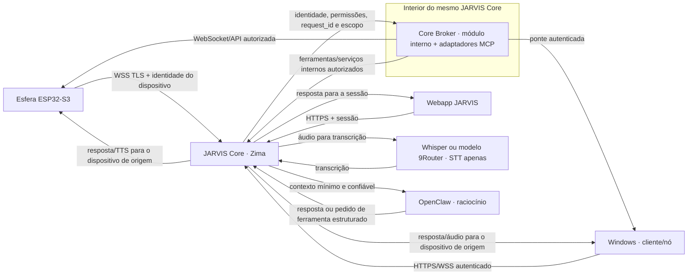

# Arquitetura-alvo: JARVIS Core único

Este é o contrato de arquitetura. ESP32/esfera, cliente Windows, webapp e qualquer outro dispositivo JARVIS falam **somente com o JARVIS Core**. O OpenClaw é o agente de raciocínio no servidor; não é gateway de dispositivos, não recebe conexão direta dos clientes e não hospeda ferramentas/MCP do JARVIS.



## Envelope de contexto por solicitação

**JARVIS Core e Core Broker são uma única central lógica e operacional.** O Broker é uma camada interna de execução de ferramentas/adaptadores MCP no Core, não um serviço, daemon ou ponto de entrada independente. O desenho de subgraph abaixo representa composição interna, não uma chamada de rede entre duas centrais.

O Core valida a sessão/token e cria o envelope no servidor; não confia em `user_id`, `device_id`, permissões ou ferramentas enviados como texto pelo modelo ou pelo cliente.

```json
{
  "request_id": "id-gerado-pelo-core",
  "source": { "device_id": "id-validado", "kind": "sphere|windows|webapp" },
  "owner": { "user_id": "id-resolvido-pelo-core", "role": "papel-validado" },
  "transcript": "texto transcrito pelo serviço STT do Core",
  "capabilities": ["somente ferramentas autorizadas para este usuário e dispositivo"]
}
```

O identificador de dispositivo e o usuário dono vêm do cadastro/autenticação do Core. A lista de capacidades é calculada pelo Core por solicitação. Para uma fala da esfera, a saída de áudio e qualquer tela/controle voltam ao mesmo `device_id`; uma solicitação do Windows ou webapp não pode redirecionar a resposta para outro dispositivo sem autorização.

## Limites obrigatórios

- O Core é o único ingresso e roteador de áudio, transcrição, chat, ferramentas e retorno visual/sonoro.
- Serviços auxiliares como o Screen Router podem existir como backends privados do Core; nenhum cliente/dispositivo conecta diretamente a portas deles.
- STT ocorre no Core: Whisper local/contêiner ou provedor de transcrição 9Router configurado **somente** para STT. O texto transcrito é o que segue para o OpenClaw.
- O Core acrescenta ao texto o dispositivo de origem, usuário validado, `request_id` e as capacidades autorizadas. Não injeta históricos longos nem credenciais.
- O OpenClaw recebe contexto e devolve texto/resposta ou uma solicitação estruturada ao Core. Não conecta diretamente à esfera, Windows, webapp, serviços de usuário ou MCP de terceiros.
- O registro e os adaptadores MCP ficam no Core. O agente só pode pedir uma ação por meio do broker do Core, que valida escopo/usuário/dispositivo e executa/roteia; nunca recebe chaves das ferramentas.
- WebSocket da esfera é autenticado por dispositivo e TLS. Windows é um nó de execução/captura, não um agente e não um segundo Core. O webapp usa sessão autenticada.
- Falha, dispositivo offline ou ação fora de escopo devem retornar erro explícito; não escolher outro dispositivo como fallback silencioso.

## Estado da migração (11/10/2026 · atualização 05:30 BRT)

| Parte | Estado observado | Próximo passo necessário |
|---|---|---|
| Windows → OpenClaw direto | O cliente fonte não inicia mais `OpenClawConnection`; a bandeja acompanha a ponte do Core. | Remover o módulo/credencial legado após confirmar o executável distribuído e atualizar o pacote Windows. |
| Windows → Core único | A ponte de comandos já consulta o Core, mas a voz, o console e partes da ilha ainda apontam para `localhost:8080`; o app ainda pode iniciar uma cópia local de `server.py`. | Migrar todos esses clientes para o endpoint Core com autenticação/identidade de dispositivo e então parar a cópia local. |
| Esfera → Core | WSS/TLS + HMAC implementado; uma autenticação física ocorreu. A sessão não permaneceu conectada e não houve fala E2E confirmada. | Manter conexão e testar fala, transcrição, resposta/TTS e roteamento de tela. |
| Tela da esfera → Core | O firmware ainda abre o canal legado HTTP/WS `:8095` diretamente para telas/controle, separado do WSS de voz `:8096`. | Mover tela/toque/controle para o canal autenticado do Core; manter o router `:8095` privado como backend ou desativá-lo para clientes após validação. |
| Core → Whisper | Containers Core e Whisper reportaram `healthy` na leitura do Zima às 05:18 BRT; a porta TCP do Whisper foi alcançada a partir do container Core. | Amanhã validar endpoint HTTP com áudio real e medir a latência; hoje não foi feita transcrição física. |
| Core → OpenClaw | A chamada remota por SSH executa o CLI `openclaw agent` no container OpenClaw do Zima. O processo estava ativo; o proprietário informou que os créditos do agente estão esgotados. O Docker health check marcou `unhealthy`. O envelope curto foi preparado no `server.py` local, sem implantação. | Amanhã, após créditos, implantar/revisar e fazer um teste de resposta; investigar também o health check. Não considerar a resposta E2E validada. |
| STT central | O Core possui Whisper em container; sem credenciais/modelos 9Router STT verificados nesta etapa. | Validar latência de fala da esfera e decidir/configurar um modelo 9Router apenas para transcrição, se desejado. |
| Identidade/escopo | A webapp tem sessão; há autenticação do WSS e da ponte Windows. Alguns handlers ainda recebem `device_id` no corpo e usam “última esfera”. | Cadastro confiável por dispositivo, vínculo dono↔dispositivo e contexto de solicitação não global; eliminar seleção por estado global. |
| Ferramentas/MCP e Core Broker | Ferramentas JARVIS existem no serviço `mcp_hud_server.py` do Core, mas a existência desse serviço não confirma round-trip. Core Broker é conceitualmente parte do Core, nunca uma central independente; a integração estruturada OpenClaw→Broker→ferramenta→resultado ainda não foi validada. A configuração MCP efetiva do OpenClaw também não foi auditada. | Completar o broker como módulo interno do Core, validar contexto escopado e round-trip; só depois remover MCPs e credenciais diretas do OpenClaw. |
| Webapp → Core único | As páginas servidas pela instalação Core usam seus endpoints; não foi auditado cada cliente/instância. | Confirmar que webapp de produção aponta apenas ao Core e inclui a sessão/usuário em cada comando. |

### Não declarar pronto antes destes testes

1. Teste autenticado de cada origem (esfera, Windows e webapp), com usuário e dispositivo resolvidos pelo Core.
2. Verificar que áudio bruto vai apenas a STT no Core e que só a transcrição/contexto mínimo chega ao OpenClaw.
3. Fazer o OpenClaw pedir uma ferramenta: broker valida usuário, proprietário do dispositivo, capacidade e `request_id`; Core executa e devolve resultado ao mesmo turno.
4. Confirmar retorno por áudio/tela apenas ao dispositivo de origem e erro claro quando offline.
5. Verificar que Windows não abre OpenClaw nem hospeda um segundo router; confirmar processo e logs depois de atualizar o executável distribuído.

## Regra para mudanças futuras

Antes de adicionar um cliente, ferramenta ou integração, desenhar a rota passando pelo Core. Não criar conexões cliente→OpenClaw ou cliente→MCP individual. Atualizar este documento e `contexto_para_agentes.md` com o estado **implementado**, **testado** ou **pendente** — sem misturar esses rótulos.
