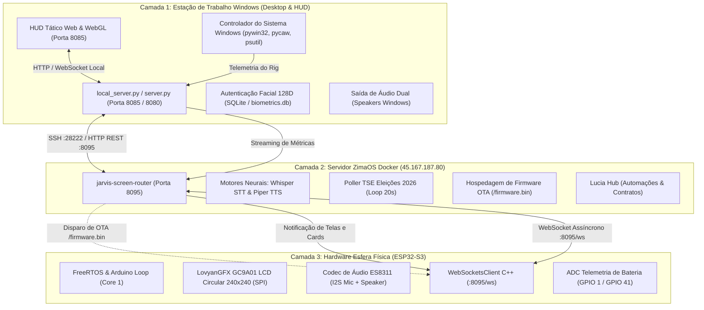
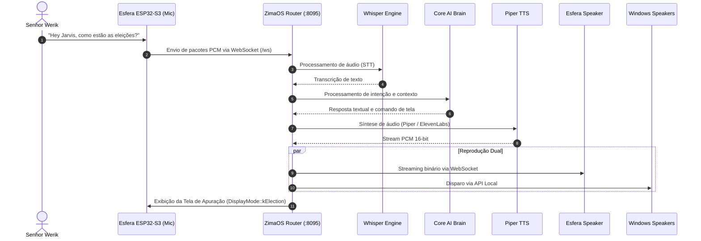

# Especificação de Arquitetura do Sistema J.A.R.V.I.S.

> Documento Técnico de Arquitetura & Integração de Sistemas Multi-Camada

---

## 1. Visão Geral da Arquitetura

O sistema **J.A.R.V.I.S.** adota uma arquitetura distribuída híbrida em três camadas (Windows PC, ZimaOS Cloud/Edge e Hardware Embarcado ESP32-S3). Esta segregação garante alta disponibilidade, processamento local com baixa latência para interação por voz e display circular físico, além de robustez e desacoplamento de serviços críticos.

---

## 2. Detalhamento dos Componentes

### 2.1 Camada 1: Estação de Trabalho Windows (Desktop & HUD)

- **Local Server (`c:\JARVIS\server.py` e `c:\JARVIS\jarvis-windows\core\local_server.py`):**
  - Executa na porta local `8085` (ou `8080` para API legada).
  - Provê endpoints REST para controle de hardware local, volume de áudio via `pycaw`, fechamento/abertura de programas e telemetria em tempo real (CPU, RAM, GPU Nvidia via `pynvml`/`nvidia-smi`).
  - Implementa controle de acesso RBAC baseado em sessões assinadas com segredo efêmero (HMAC SHA-256).
- **Autenticação Biométrica Facial (`c:\JARVIS\biometrics.py`):**
  - Baseada em descritor facial de 128 dimensões processado no cliente e validado contra banco SQLite local (`auth/biometrics.db`).
  - O perfil do **Senhor Werik** concede permissão de Superusuário irrestrito com bypass automático para ações originadas na Esfera física.
- **Saída Dual de Áudio:**
  - As respostas de voz sintetizadas são tocadas no alto-falante integrado da Esfera física via I2S e, em paralelo, reproduzidas na estação de trabalho para imersão acústica total.

### 2.2 Camada 2: Servidor ZimaOS Docker (`45.167.187.80`)

- **Roteador Central de Telas e Áudio (`jarvis-screen-router`):**
  - Host: `45.167.187.80`, Porta de serviço: `8095`, Porta SSH de gerenciamento: `28222`.
  - Atua como hub WebSocket assíncrono mantendo conexões ativas com a Esfera ESP32-S3 e com clientes desktop.
  - Endpoints principais:
    - `GET /ws`: Canal bidirecional de mensagens e frames PCM de áudio.
    - `POST /api/jarvis/show_screen`: Roteamento de telas dinâmicas (cartões, gráficos, avisos).
    - `GET /firmware.bin`: Servidor de binários compilados para atualização Over-The-Air.
    - `POST /api/jarvis/ota/trigger`: Notificação imediata para a Esfera iniciar o processo OTA via Wi-Fi.
- **Poller Oficial do TSE em Background:**
  - Loop assíncrono independente que consulta a API oficial de apuração do Tribunal Superior Eleitoral a cada 20 segundos.
  - Atualiza o estado da tela eleitoral da Esfera com dados de apuração presidencial (percentuais de votos, candidatos principais Lula e Flávio Bolsonaro, e percentual total apurado).
- **Motores Neurais de Fala:**
  - **Whisper STT:** Transcrição ultra-rápida de voz processada em container Docker com aceleração.
  - **Piper TTS / ElevenLabs:** Síntese de voz com a personalidade formal britânica do J.A.R.V.I.S.

### 2.3 Camada 3: Hardware Esfera Física (ESP32-S3)

- **Controlador Principal:** ESP32-S3-WROOM-1 DevKitC-1 com 16MB Flash (configuração DIO) e PSRAM octal habilitada.
- **Display Circular GC9A01:**
  - Resolução: $240 \times 240$ pixels, raio $R = 120$.
  - Comunicação via SPI otimizada com a biblioteca LovyanGFX com DMA habilitado.
  - **Geometria Circular e Limites Cordais:** Todos os cards, textos e barras respeitam a fórmula cordal da circunferência:
    $$W(y) = 2 \cdot \sqrt{R^2 - (y - R)^2}$$
    Garantindo que nenhum texto ou elemento gráfico seja cortado nas bordas circulares.
- **Codec de Áudio ES8311:**
  - Comunicação I2S para microfone com pré-amplificação calibrada (+30dB) e alto-falante embutido.
  - Taxa de amostragem: 16 kHz, 16-bit PCM mono.
- **Conectividade Wi-Fi Resiliente:**
  - Conexão primária na rede `Jarvis` (`ironman123`).
  - Fallback automático com reconexão exponencial para a rede secundária `WEGI_2G` (`Wegi#2520`).
  - Transmissão ininterrupta de telemetria de bateria, Wi-Fi RSSI e estado de carga.

---

## 3. Fluxo de Vida de Mensagens e Áudio

---

## 4. Política de Segurança e Alta Disponibilidade

1. **Proteção de Segredos:**
   - Nenhuma chave de API ou senha permanece gravada em repositório público.
   - Variáveis sensíveis do ESP32-S3 são compiladas a partir de `firmware_jarvis_custom/include/jarvis_sphere_secrets.h` (ignorado no Git).
   - Servidores locais utilizam `.env` protegido com permissões restritas.
2. **Autonomia Local:**
   - Em caso de falha de conexão de rede externa (Internet ou link com ZimaOS), a interface Windows PC opera em modo autônomo e a Esfera física mantém a interface do relógio e status local sem travamento do sistema.
3. **Prevenção de Instâncias Múltiplas:**
   - O cliente de desktop Windows enforce Mutex nomeado global (`Global\JARVIS_SINGLE_INSTANCE`), impedindo que múltiplos processos em background concorram pelas portas de áudio ou serial.
